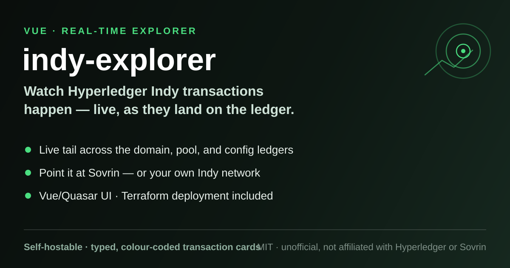

# indy-explorer

<p align="center"></p>

**An unofficial, real-time transaction explorer for [Hyperledger Indy](https://www.hyperledger.org/projects/hyperledger-indy) networks.**

A single-page web app (Vue 2 + [Quasar](https://quasar.dev) v1) that tails the three ledgers of an
Indy network — **DOMAIN**, **CONFIG** and **POOL** — side by side, renders each transaction as a
typed, colour-coded card, and picks up new transactions as they land on the ledger.

Originally built as the *Tykn Indy Inspector* to watch transactions on the
[Sovrin](https://sovrin.org) network; the default configuration ships with the Sovrin Builder,
Staging and MainNet environments and a network switcher in the header.

> **Unofficial.** This project is community-maintained and is **not affiliated with, endorsed by,
> or sponsored by** the Hyperledger Foundation, the Linux Foundation, or the Sovrin Foundation.
> "Hyperledger", "Indy" and "Sovrin" are used here descriptively, only to say what this software
> interoperates with.

## Features

Everything below is visible in the code — no more, no less.

- **Three ledgers, one screen.** DOMAIN, CONFIG and POOL transactions in parallel columns, newest
  first, with infinite scroll paging backwards from the ledger tip.
- **Live tail.** Once loaded, the app checks the DOMAIN ledger tip every 30 seconds and prepends
  new transactions as they arrive.
- **Typed transaction cards.** Dedicated card components for `NYM`, `ATTRIB`, `SCHEMA`,
  `CRED_DEF`, `REVOC_REG_DEF`, `REVOC_REG_ENTRY`, `NODE`, `POOL_UPGRADE`, `NODE_UPGRADE`,
  `POOL_CONFIG`, `AUTH_RULES`, `TXN_AUTHOR_AGREEMENT` and its AML variants — with a generic
  fallback for anything else. Each type gets its own colour.
- **Per-ledger filters.** Toggleable filter chips narrow each column down to the transaction
  types you care about.
- **Summary bar.** Total and per-ledger transaction counts for the selected network, plus how
  many are loaded in the browser.
- **Raw JSON on demand.** Any card opens a pretty-printed JSON dialog with the full transaction
  (via `vue-json-pretty`).
- **NYM resolution.** Transaction authors are resolved to their NYM: first from an in-memory
  cache, otherwise by submitting a `GET_NYM` (type `105`) read request through the API. NYM roles
  are translated to their names (`TRUSTEE`, `STEWARD`, `TRUST_ANCHOR`, `NETWORK_MONITOR`, …).
- **Network switcher.** A dropdown in the header flips between the configured networks
  (`sovmain`, `sovstaging`, `sovbuilder` by default).
- **Installable PWA.** Ships a web-app manifest and icons, so it can be installed from the
  browser.

## How it works

An Indy network is bootstrapped from a **genesis transaction file**: a list of `NODE`
transactions giving the address and keys of each validator. That file is how any Indy client
finds the pool — a sample genesis file for a local four-node pool is included at
[`GenesisTx.json`](GenesisTx.json).

This repository is the **frontend only**. It does not talk to the validator nodes directly;
instead it polls a small companion **REST API** that connects to the pool (using such a genesis
file) and exposes the ledgers over HTTP:

1. **Genesis file → pool.** The backend joins the Indy pool described by the genesis file.
2. **REST API → ledger reads.** The frontend calls `GET {apiurl}/{network}/sizes` for ledger
   sizes and `GET {apiurl}/{network}/tx/{ledger}/{seqNo}/{count}/false` for transactions, and
   `POST {apiurl}/{network}/tx` to submit read requests such as `GET_NYM`.
3. **Live UI.** A Vuex store keeps per-network, per-ledger transaction maps; infinite scroll
   loads history backwards from the tip (10 per page), while a 30-second updater fetches whatever
   is newer than the highest sequence number seen.

The default `apiurl` points at `https://rest-api.tykn.tech`, the API instance the app was
originally deployed against.

## Getting started

Requires Node and [Yarn](https://yarnpkg.com) (the toolchain is Quasar v1 / Vue 2 era — an older
Node such as v10–v14 is the safest bet; CI used Node 10).

```bash
git clone https://github.com/eduelias/indy-explorer.git
cd indy-explorer
yarn                # install dependencies

npx quasar dev      # dev server with hot reload (opens a browser window)
yarn lint           # ESLint + Prettier, with --fix
yarn build          # production build -> dist/spa
```

## Configuration

Network configuration lives in the Vuex store, in
[`src/store/transactions/state.js`](src/store/transactions/state.js). To point the explorer at
your own network:

1. Set `apiurl` to your REST API instance (it must expose the `/{network}/sizes`,
   `/{network}/tx/...` and `POST /{network}/tx` endpoints described above).
2. Add an entry for your network under `nets` (copy one of the existing blocks — each network
   needs `DOMAIN`, `POOL` and `CONFIG` sub-objects plus a `nymCache`).
3. Set `network` to your network's key so it is selected by default.
4. Add the network key to the dropdown `:options` list in
   [`src/layouts/MyLayout.vue`](src/layouts/MyLayout.vue).

There is no runtime configuration — values are compiled into the bundle at build time.

## Deployment

The included [`terraform/`](terraform/) configuration deploys the built SPA as a public static
website on a Google Cloud Storage bucket, fronted by a Cloudflare CNAME. A GitHub Actions
workflow (`.github/workflows/`) runs Terraform and then syncs `dist/spa/` to the bucket on every
published release. Environment variable files for dev/test/prod live in
[`terraform/conf/`](terraform/conf/).

## Trademarks

"Hyperledger" and "Hyperledger Indy" are trademarks of the Linux Foundation. "Sovrin" is a
trademark of the Sovrin Foundation. This project is an independent, unofficial tool; the marks
are used only to describe compatibility and origin, and no affiliation or endorsement is implied.

## License

Licensed under the [MIT License](LICENSE).
